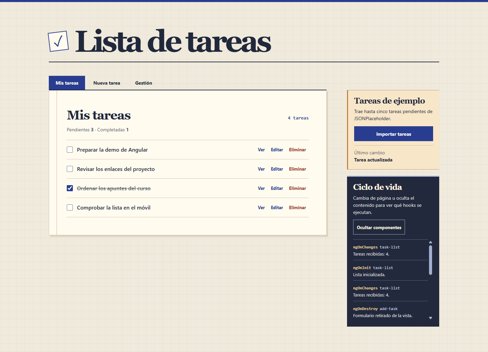

# Cuaderno de tareas · Angular

Lista de tareas desarrollada durante el curso de Angular de Edutin Academy.
Permite crear y editar tareas, completar pendientes, recuperar elementos de la
papelera e importar ejemplos desde JSONPlaceholder. El proyecto reúne formularios
de plantilla y reactivos, servicios con RxJS, persistencia en `localStorage` y
rutas protegidas con carga diferida y precarga selectiva.



## Requisitos y versiones

Se necesita Docker Desktop iniciado con contenedores Linux y Docker Compose,
además de Git para versionar los cambios. Las herramientas se ejecutan dentro
del contenedor: Node **26.13.0 LTS**, npm **11.20.0** y Angular CLI **22.2.6**.

## Arrancar el entorno

Desde la raíz del repositorio:

```sh
git config --local core.hooksPath .githooks
docker compose up -d --build
docker compose exec -T angular npm ci
docker compose exec angular sh
```

La terminal del contenedor se abre en `/workspace`, que corresponde a la raíz
del repositorio en el equipo. El contenedor permanece en espera y no inicia ningún
servidor. Las dependencias y la caché de npm se guardan en volúmenes Docker.

Para consultar las versiones o parar el entorno:

```sh
docker compose exec angular node --version
docker compose exec angular npm --version
docker compose exec angular ng version
docker compose down
```

## Trabajar con el proyecto

El proyecto ya está inicializado. Desde la terminal del contenedor, puedes
arrancar el servidor con:

```sh
ng serve --host 0.0.0.0 --port 4200 --poll 1000
```

Entonces estará disponible en [http://localhost:4200](http://localhost:4200). El
puerto se publica solo en la interfaz local y el sondeo permite detectar cambios
en Windows y OneDrive.

Para reinstalar las dependencias desde el fichero de bloqueo, ejecutar en la
terminal del equipo `docker compose exec angular npm ci`. Los archivos de código
y configuración están en la raíz; `node_modules` permanece en su volumen Docker.

El README original generado por Angular CLI se conserva en
[docs/ANGULAR_CLI.md](docs/ANGULAR_CLI.md).

## Práctica 1 · Lista de tareas

El formulario `add-task` se creó manualmente con TypeScript, HTML y CSS en
archivos separados. La lista partió de este comando de Angular CLI:

```sh
ng generate component task-list --style=css --skip-tests
```

`add-task` emite el título y el componente raíz actualiza el estado. `task-list`
recibe el nuevo array de tareas y conserva las filas existentes por identificador.
En esta primera práctica las tareas vivían en memoria. La actividad 3 incorpora el guardado local.

| Acción              | Qué se observa                                                                          |
| ------------------- | --------------------------------------------------------------------------------------- |
| Abrir la aplicación | `ngOnInit` en ambos componentes y `ngAfterViewInit` en `add-task`, que enfoca el campo. |
| Añadir una tarea    | `ngOnChanges` en `task-list` muestra el nuevo total sin recrear la lista.               |
| Ocultar componentes | `ngOnDestroy` en ambos componentes.                                                     |
| Volver a mostrarlos | Se inicializan nuevas instancias y vuelven a aparecer las tareas.                       |

Ambos componentes usan `OnPush`. Al añadir una tarea se sustituye el array y
`@for` sigue cada fila por su identificador. Una prueba verifica que la fila
anterior conserva su nodo DOM después de añadir otra. El panel muestra solo
los últimos 12 eventos para limitar la instrumentación de la práctica.

## Actividad 2 · Data Binding y formularios

La lista recibe tareas de dos formularios independientes. El título principal,
los títulos de las tareas y el contador se muestran mediante interpolación.

| Formulario | Qué se puede comprobar                                                                                              |
| ---------- | ------------------------------------------------------------------------------------------------------------------- |
| Plantilla  | `[(ngModel)]` actualiza la vista previa. `required`, `minlength` y `maxlength` validan el título.                   |
| Reactivo   | `ReactiveFormsModule` enlaza un `FormGroup`. El panel muestra `pristine`, `dirty`, `valid` e `invalid` del control. |

En ambos formularios, `[disabled]` depende del estado de validez. El enlace
`(click)` solicita el envío del formulario y `(ngSubmit)` valida, emite el título
y reinicia el formulario que se envió. Pulsar Intro sigue el mismo flujo.
Los títulos se guardan sin espacios en los extremos y necesitan al menos tres
caracteres tras ese recorte.

Para ver los estados, escribe `Ab` en el formulario reactivo y luego completa
`Abrir el proyecto`. Al añadir la tarea, el campo vuelve a `pristine` e `invalid`
porque se vacía. En el formulario de plantilla, escribe un título válido y
observa cómo cambia la vista previa antes de enviar.

## Actividad 3 · Servicios, LocalStorage y RxJS

Los dos servicios se generaron con Angular CLI:

```sh
ng generate service services/task-store --injectable --skip-tests
ng generate service services/task-api --injectable --skip-tests
```

Ambos usan `@Injectable({ providedIn: 'root' })`. `TaskStore` concentra el CRUD
y guarda la lista en `LocalStorage` bajo la clave `curso-angular.tasks`. Publica
la lista con un `BehaviorSubject` y los cambios puntuales con un `Subject`.
La aplicación recibe ambos flujos como `Observable` y muestra el último cambio.
La restauración se realiza en el navegador después del primer renderizado.

`TaskApi` usa `HttpClient` para hacer un GET a [JSONPlaceholder](https://jsonplaceholder.typicode.com/).
El `pipe` transforma la respuesta con `map`, descarta registros inválidos o ya
completados con `filter`, limita la salida a cinco y usa `catchError` para ofrecer
un reintento. Una segunda importación omite los identificadores externos que
ya están en la lista.

Para probarlo, crea una tarea, edita su título, marca su casilla e importa los
ejemplos. Recarga la página para comprobar que se conservan. En la actividad 4,
eliminar una tarea la mueve a la papelera.

## Actividad 4 · Routing y carga diferida

| Ruta                                 | Qué se puede hacer                                                            |
| ------------------------------------ | ----------------------------------------------------------------------------- |
| `/tareas`                            | Consultar la lista, marcar tareas como completadas y enviarlas a la papelera. |
| `/tareas/nueva`                      | Crear tareas con los formularios de plantilla y reactivo.                     |
| `/tareas/:id` y `/tareas/:id/editar` | Consultar una tarea y modificar su título.                                    |
| `/tareas/gestion/completadas`        | Consultar tareas completadas y volver a marcarlas como pendientes.            |
| `/tareas/gestion/eliminadas`         | Consultar la papelera y restaurar una tarea conservando su estado.            |
| `/acceso`                            | Iniciar una sesión de demostración con `demo` y `angular-demo`.               |

Las rutas hijas de `/tareas` se muestran en su `router-outlet`. Gestión tiene
otro `router-outlet` para alternar entre completadas y papelera. Si no hay una
sesión activa, el guard `canMatch` redirige a `/acceso`. Las credenciales de
demostración permiten volver a la subruta solicitada. La sesión vive en
`sessionStorage` y el guard comprueba una sesión de demostración en el cliente.
El servidor entrega la aplicación para renderizar las rutas en el navegador,+donde residen la sesión y las tareas.

Gestión es un `NgModule` que se carga mediante `loadChildren` al entrar con una
sesión activa. La edición usa `loadComponent` bajo demanda. La estrategia
selectiva solo precarga **Nueva tarea** después de la primera navegación.
En la pestaña Red del navegador puedes comprobar que el archivo de gestión
aparece al iniciar sesión y entrar en la sección.

## Controles de calidad

El precommit y GitHub Actions comprueban la configuración de Compose, construyen
la imagen y ejecutan los controles de infraestructura y aplicación. El
[perfil de estilo](docs/ESTILO.md) documenta las reglas y la revisión manual.

El hook revisa una instantánea del contenido preparado para el commit y conserva
los cambios sin preparar. Está instalado en este clon; al clonar de nuevo hay
que ejecutar `git config --local core.hooksPath .githooks`. Docker debe estar
iniciado para hacer commits.

Para ejecutar los controles de la aplicación desde la terminal del equipo:

```sh
docker compose exec -T angular npm run check
```
